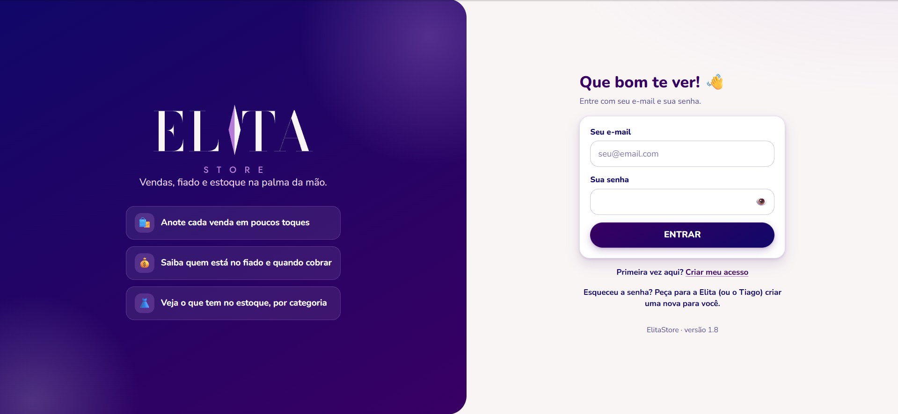
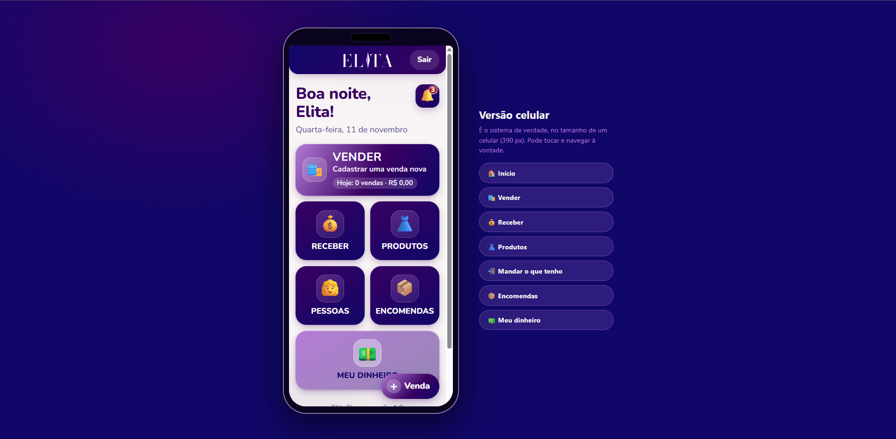

# ElitaStore

**Vendas, fiado e estoque na palma da mão.**

Sistema web feito sob medida para uma pequena loja: a dona anota as vendas pelo celular, controla quem está no fiado e quando cobrar, organiza o estoque e acompanha o dinheiro que entrou e o que falta receber.

Projeto da **Duo Tech** (Diego Henrique e Tiago Mello). Em uso real em [elitastore.com.br](https://elitastore.com.br).

> Este repositório é a **versão pública** do projeto: código do sistema, estrutura do banco e testes. Dados da loja, chaves de acesso e documentos internos ficam no repositório privado.

| Computador | Celular |
|---|---|
|  |  |

## O problema

O pequeno empresário costuma anotar o fiado no caderninho, controlar o estoque de cabeça e chegar ao fim do mês sem saber quanto entrou. Os sistemas prontos são caros, complicados e pensados para empresas grandes. O ElitaStore é o oposto: telas grandes, poucos toques e só o que a loja usa de verdade.

## O que o sistema faz

- **Vender:** registra a venda em poucos toques, à vista, no fiado ou com pagamento dividido (dinheiro, Pix e cartão), com desconto.
- **Receber:** mostra quem está devendo, há quanto tempo e gera a mensagem de cobrança no WhatsApp com a chave Pix.
- **Produtos:** estoque por categoria, com fotos, aviso de produto acabando, parado ou perto da validade e leitura de código de barras pela câmera.
- **Pessoas:** cadastro de clientes com WhatsApp e endereço (busca pelo CEP).
- **Encomendas:** pedidos das clientes e aviso pelo WhatsApp quando chegam.
- **Meu dinheiro:** o que entrou, o que falta receber e os dados da loja.
- **Equipe:** a dona libera o acesso de ajudantes, cada um com o seu login.
- Funciona no **celular e no computador** e pode ser instalado como aplicativo (PWA).

## Tecnologia

| Parte | Ferramenta |
|---|---|
| Linguagem | Python 3.12 |
| Servidor web | FastAPI + Uvicorn |
| Telas | HTML com Jinja2 (geradas no servidor) e CSS próprio |
| Banco, login e fotos | Supabase (PostgreSQL com RLS em todas as tabelas) |
| Imagens | Pillow (as fotos são reduzidas antes de subir) |
| Testes | pytest |
| Publicação | Docker, Render e domínio próprio |

### Organização (padrão MVC)

```
sistema/
├── app/
│   ├── models/        # M: dados e regras do negócio (único lugar que fala com o banco)
│   ├── views/         # V: telas HTML (Jinja), uma pasta por área
│   ├── controllers/   # C: rotas (FastAPI APIRouter), uma por área
│   ├── core/          # login/Supabase, utilidades (reais, datas, WhatsApp) e helpers web
│   ├── static/        # CSS, ícones, manifest e o simulador de celular
│   └── main.py        # liga as peças
├── supabase/migrations/  # estrutura do banco, regras de segurança (RLS) e funções
├── tests/                # testes automáticos
├── Dockerfile
└── requirements.txt
```

Cada pedido ao banco usa o token de quem está logado, então as regras de segurança do banco (RLS) valem sempre.

## Como rodar no computador

```bash
cd sistema
python -m venv .venv
.venv/Scripts/pip install -r requirements-dev.txt      # no Linux/Mac: .venv/bin/pip
cp .env.example .env                                    # preencha com o seu projeto Supabase
.venv/Scripts/python -m uvicorn app.main:app --port 8000
```

Abra http://localhost:8000. A versão de celular pode ser vista em http://localhost:8000/static/celular.html.

Para criar o banco, aplique os arquivos de `sistema/supabase/migrations/` em um projeto Supabase seu (em ordem).

Testes:

```bash
.venv/Scripts/python -m pytest -q
```

## Autores

- **Diego Henrique**: [LinkedIn](https://www.linkedin.com/in/diegohenrique-data) · [GitHub](https://github.com/diegohenrique-data)
- **Tiago Mello**

Duo Tech: tecnologia simples para quem faz o pequeno negócio girar.
